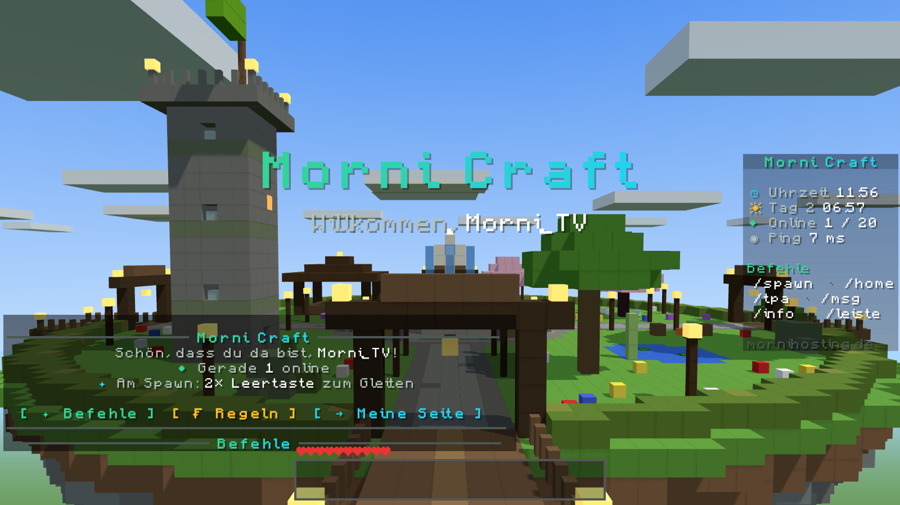
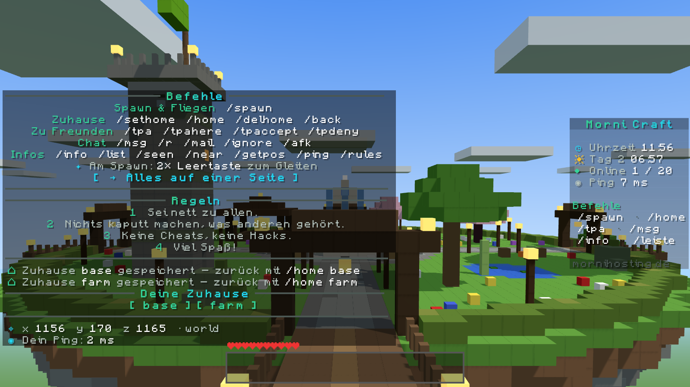
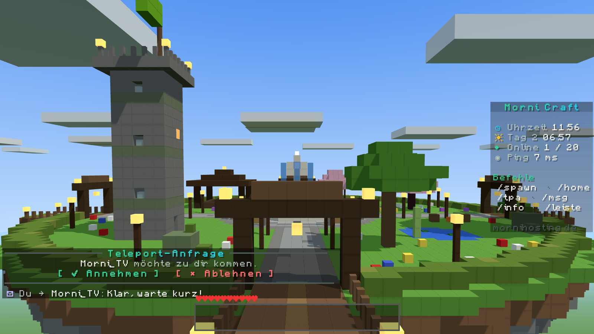
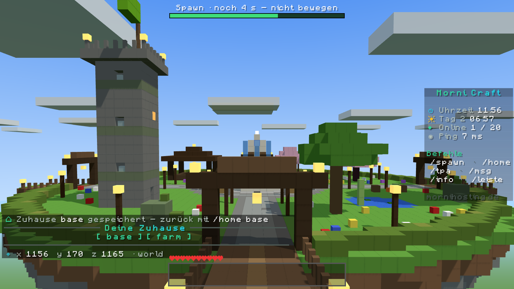
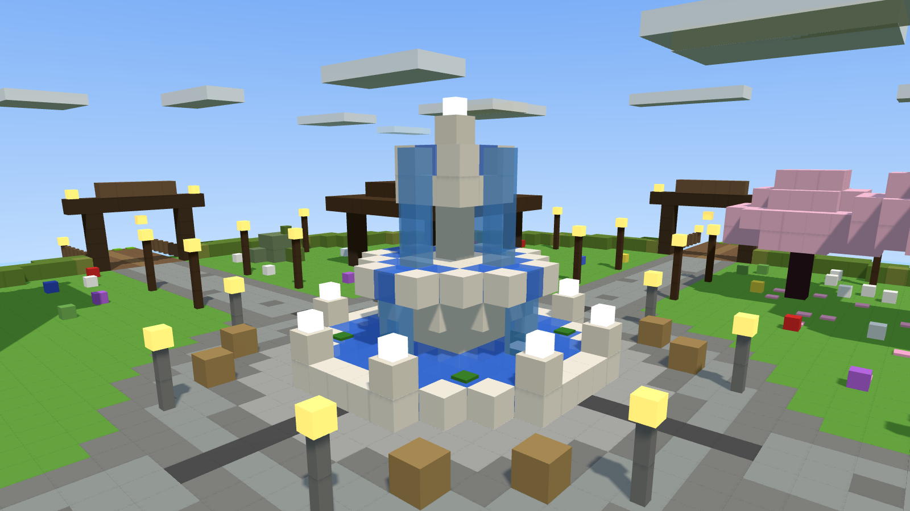
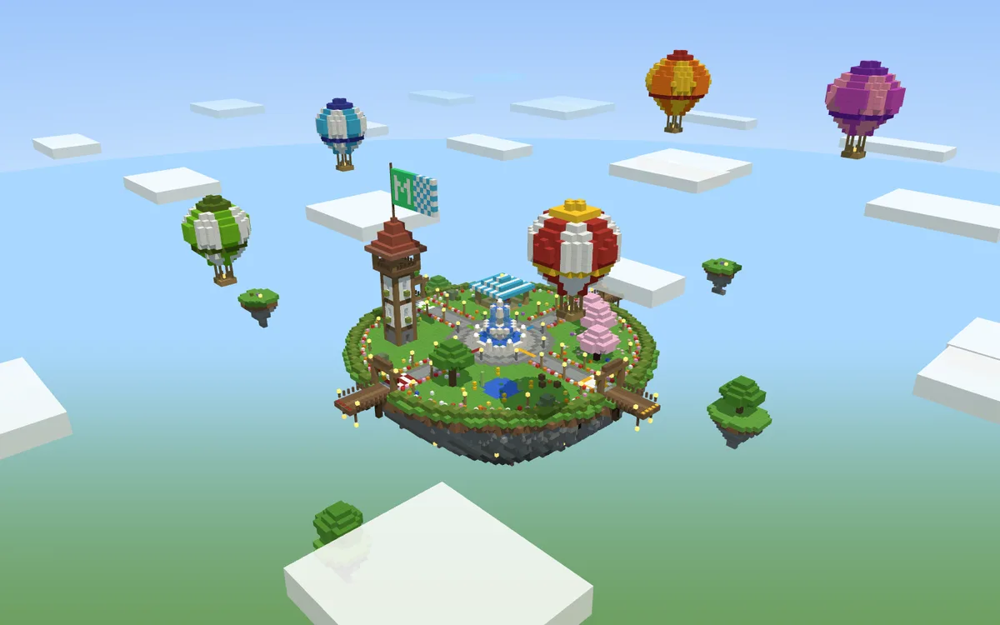
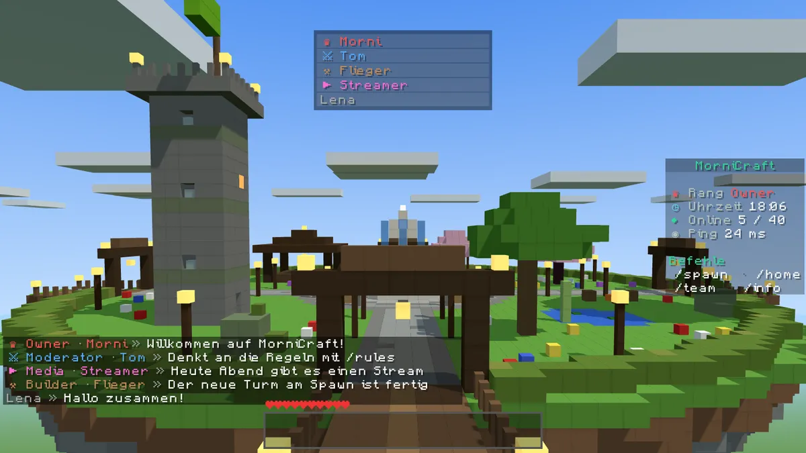
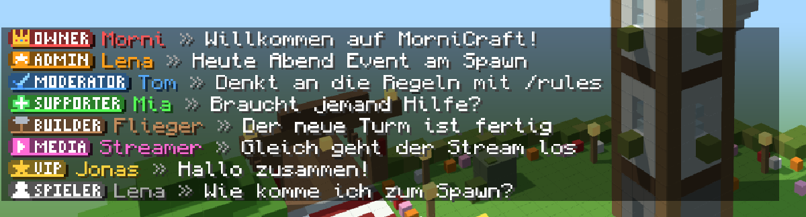

<div align="center">

# ✦ MorniCraft

**Das Plugin für deinen Freunde-Server – Spawn, Zuhause, Teleports, Nachrichten, Start-Elytra, Gräber, Team-Werkzeuge, Streamer-Modus und eine schöne Leiste. Alles in einem, auf Deutsch und Englisch.**

[](LICENSE)
[](#installation)
[](#installation)
[](#bedrock-spieler)
[](https://github.com/pmornhart/MorniCraft/releases/latest)



</div>

> [!TIP]
> **Am besten zusammen mit [MorniHosting](https://github.com/pmornhart/MorniHosting).** MorniCraft läuft auch allein auf jedem Paper- oder Purpur-Server – richtig rund wird es aber mit MorniHosting, dem Web-Panel für eigene Minecraft-Server: ein Klick, und der Server steht fertig da, mit Spawn-Insel über dem Meer, allen Versionen, Statistik-Seite und **allen Einstellungen als Schalter im Browser** statt in einer Datei. [Mehr dazu ↓](#am-besten-mit-mornihosting)

---

## Was MorniCraft kann

| | |
|---|---|
| 🏝️ **Spawn** | `/spawn`, geschützter Spawn-Bereich (nur Admins bauen), kein Schlafen und kein Kämpfen am Spawn – alles abschaltbar. Auf der Insel und den Nebeninseln tauchen keine Tiere oder Monster auf, unter der Insel keine Monster, und wer runterfällt, bekommt keinen Fallschaden |
| 👑 **Ränge** | Owner, Moderator, Builder, Media, VIP, Spieler – Symbol und Farbe (oder ein Abzeichen) vor dem Namen im **Chat**, in der **Tab-Liste** und **über dem Kopf**, dazu passende Rechte. `/team` zeigt, wer welchen Rang hat |
| 🪽 **Start-Elytra** | Am Spawn abspringen und **2× Leertaste** = echte Flügel an und losgleiten (Überlebensmodus, ohne Schub nach oben), kein Fallschaden, **F** (Bedrock: Schleichen) = ein Schub. Nach der Landung ist die eigene Brustplatte wieder da |
| 🏠 **Zuhause** | `/sethome`, `/home`, `/homes` öffnen ein Fenster mit einem **Bett pro Zuhause** (Linksklick = hin, 2× Rechtsklick = löschen, graue Betten = freie Plätze), `/delhome`, `/back` – auch zurück zum Todesort |
| ⚰️ **Gräber** | Wer stirbt, bekommt ein Grab mit Steinkreuz und seinem Kopf. Alle Sachen, die XP und der eigene Kopf als Andenken liegen darin – anklicken, rausnehmen. Die ersten 15 Minuten nur für dich (und das Team), danach für alle. Leer = Grab verschwindet |
| 🛡️ **Team-Werkzeuge** | Gefängnis, Stummschalten, Einfrieren – mit Dauer und Grund. Ducken + Rechtsklick auf einen Spieler öffnet ein Team-Fenster (Infos, hin/herholen, Zuhause, Inventar, heilen, kicken …) |
| 🎥 **Streamer-Modus** | `/streamer` versteckt IP-Adressen, Koordinaten und private Nachrichten. Die anderen sehen „● LIVE“ vor deinem Namen |
| ⚑ **Clans** | Jeder kann mit `/clan` einen Clan gründen: Menü mit Mitgliedern, **Clan-Basis** als gemeinsames Zuhause, Clan-Chat `/cc`, Kürzel `[TAG]` hinter dem Namen im Chat, kein Schaden unter Mitgliedern (abschaltbar) |
| ⏱️ **Begrenzungen** | `/spawn`, `/home`, `/tpa`, `/back` z. B. nur 1× pro Stunde oder 3× am Tag – oder ganz abschalten. Admins sind frei |
| 🤝 **Teleports** | `/tpa`, `/tpahere` mit Knöpfen **✔ Annehmen / ✖ Ablehnen**, 5 Sekunden stillstehen (Balken oben, Bewegen bricht ab) |
| ✉️ **Nachrichten** | `/msg`, `/r`, `/mail` (auch an Spieler, die gerade nicht da sind), `/ignore`, `/afk` |
| 📋 **Leiste rechts** | Uhrzeit, Spielzeit (Tag/Nacht), wer online ist, Ping und die wichtigsten Befehle, sauber in Spalten – jeder kann sie mit `/leiste` ausblenden |
| ⚔️ **Tab-Liste** | Kills ⚔ und Tode ☠ neben jedem Namen, nach Rang sortiert |
| 👋 **Begrüßung** | Großer Titel und eine Karte mit Knöpfen – nur beim allerersten Betreten |
| 🧨 **Welt-Schalter** | TNT, Creeper-Löcher, Feuer-Ausbreitung, Endermen – jeweils an oder aus |
| 📱 **Bedrock** | Mit Floodgate echte Bedrock-Menüs: Teleport-Anfragen als Ja/Nein-Fenster, `/info` als Menü mit Knöpfen |
| 🔄 **Updates** | Sagt Admins Bescheid, wenn es eine neue Version gibt |
| 🔁 **Umstieg** | Zuhause aus **EssentialsX** werden automatisch übernommen |

<table>
<tr>
<td></td>
<td></td>
</tr>
<tr>
<td align="center"><code>/info</code> – alle Befehle, zum Anklicken</td>
<td align="center">Teleport-Anfrage mit Knöpfen</td>
</tr>
<tr>
<td></td>
<td></td>
</tr>
<tr>
<td align="center">5 Sekunden stillstehen – der Balken läuft ab</td>
<td align="center">Die Spawn-Insel (Datapack, optional)</td>
</tr>
</table>

<sub>Die Bilder sind echte Nachrichten eines Test-Servers, für die Vorschau im Minecraft-Stil nachgezeichnet.</sub>

## Getestet

Mit echtem Paper-Server und Test-Spieler geprüft (Plugin startet, Begrüßung, Titel, Teleport-Balken, Zuhause, Leiste, `/info`):

| 1.17.1 | 1.18.2 | 1.19.4 | 1.20.1 | 1.20.4 | 1.20.6 | 1.21.1 | 1.21.4 | 1.21.8 | 1.21.11 | 26.1.2 | 26.2 | 26.3 |
|:-:|:-:|:-:|:-:|:-:|:-:|:-:|:-:|:-:|:-:|:-:|:-:|:-:|
| ✅ | ✅ | ✅ | ✅ | ✅ | ✅ | ✅ | ✅ | ✅ | ✅ | ✅ | ✅¹ | ✅¹ |

<sub>¹ Plugin startet und alle Befehle antworten; der Test-Spieler kann diese Versionen noch nicht, deshalb ohne Spieler geprüft.</sub>

## Installation

Du brauchst einen **Paper**- oder **Purpur**-Server ab **1.17** (bis zur neuesten Version, auch 26.x) mit **Java 17** oder neuer.

1. **Herunterladen:** [`MorniCraft.jar`](https://github.com/pmornhart/MorniCraft/releases/latest) aus dem neuesten Release.
2. **Reinlegen:** Die Datei in den Ordner `plugins/` deines Servers kopieren.
3. **Starten:** Server starten (oder neu starten). MorniCraft legt `plugins/MorniCraft/config.yml` an.
4. **Einstellen:** `config.yml` nach Wunsch ändern (siehe [Einstellungen](#einstellungen)) und im Spiel `/mornicraft reload` tippen.

Fertig. Hattest du vorher **EssentialsX** oder **SpawnElytra**? Dann diese Plugins aus `plugins/` nehmen – MorniCraft übernimmt die Zuhause aus EssentialsX beim nächsten Betreten automatisch.

### Empfohlen dazu

| Plugin | Wofür |
|---|---|
| [ViaVersion](https://modrinth.com/plugin/viaversion) + [ViaBackwards](https://modrinth.com/plugin/viabackwards) | Spieler mit **jeder Minecraft-Version** können rein |
| [Geyser](https://geysermc.org/download) + [Floodgate](https://geysermc.org/download) | **Bedrock-Spieler** (Handy, Konsole, Windows) können rein – und bekommen MorniCraft-Menüs |
| [Chunky](https://modrinth.com/plugin/chunky) | Welt vorab erzeugen, damit niemand ruckelt |

### Spawn-Insel (Datapack, optional)

Eine schwebende Insel hoch über der Welt, hell und bunt mit etwas Bayern-Flair: Brunnen mit drei Schalen, weißer Aussichtsturm mit rotem Dach und MorniCraft-Flagge, Pavillon mit weiß-blauem Zeltdach, Maibaum, Kirschbäume, Tulpen an allen Wegen, Absprung-Stege für die Start-Elytra (die Himmelsrichtung steht im Pflaster), kleine Nebeninseln und fünf Heißluftballons. Braucht **Minecraft 1.20.5 oder neuer**.




1. [`MorniCraft-Spawn.zip`](https://github.com/pmornhart/MorniCraft/releases/latest) herunterladen.
2. Den Inhalt nach `world/datapacks/MorniCraft-Spawn/` entpacken (der Ordner enthält `pack.mcmeta`).
3. Im Spiel als Admin `/reload` tippen.
4. Dorthin fliegen, wo die Insel hin soll – am schönsten **über dem Meer** – und `/function craftattack:here` tippen.

Die Insel entsteht auf Höhe 170 genau über dir, der Welt-Spawn wird in die Mitte gesetzt. MorniCraft schützt sie dann automatisch.

## Befehle

| Befehl | Was er macht |
|---|---|
| `/spawn` | Zurück zum Spawn |
| `/sethome [name]` · `/home [name]` · `/homes` · `/delhome <name>` | Zuhause speichern, hinreisen, anzeigen, löschen |
| `/back` | Zurück zum letzten Ort – auch nach dem Tod |
| `/tpa <spieler>` · `/tpahere <spieler>` | Fragen, ob du zu jemandem darfst / ob jemand zu dir kommt |
| `/tpaccept` · `/tpdeny` | Anfrage annehmen / ablehnen (oder einfach auf den Knopf klicken) |
| `/clan` | Clan-Menü (gründen, einladen, Basis, Mitglieder) |
| `/clan create <name> [kürzel]` · `/clan invite <spieler>` · `/clan accept` | Clan gründen · einladen · beitreten |
| `/clan base` · `/clan setbase` · `/cc <text>` | Zur Clan-Basis · Basis setzen (Anführung) · Clan-Chat |
| `/clan leave` · `/clan kick` · `/clan disband` · `/clan tag` · `/clan pvp` · `/clan leader` | Verlassen · rauswerfen · auflösen · Kürzel · Kämpfen im Clan · Anführung abgeben |
| `/msg <spieler> <text>` · `/r <text>` | Private Nachricht / antworten |
| `/mail send <spieler> <text>` · `/mail read` | Nachricht für später / Post lesen |
| `/ignore <spieler>` | Jemanden im Chat ausblenden |
| `/afk` | Zeigt allen, dass du kurz weg bist |
| `/seen <spieler>` · `/near` · `/getpos` · `/ping` | Wann zuletzt da · wer in der Nähe · Koordinaten · Verbindung |
| `/info` · `/rules` · `/leiste` | Alle Befehle · Regeln · Leiste rechts ein/aus |
| `/team` | Wer im Team ist (alle Ränge mit Spielern) |
| `/streamer` | Streamer-Modus: Menü mit Schaltern (auch `/streamermodus`, `/stream`) |
| `/mornicraft reload` | Einstellungen neu laden (Admins) |

**Für das Team** (Recht `mornicraft.moderate`, Admins immer):

| Befehl | Was er macht |
|---|---|
| `/gefaengnis <spieler> [10m\|1h\|1d] [grund]` | Ab in die schwebende Zelle (Abenteuermodus, Balken zeigt die Restzeit, nur `/msg`, `/mail`, `/info` erlaubt). Danach geht es zurück an den alten Ort |
| `/gefaengnis hier` | Setzt die Zelle an deinen Ort (nur Admins) |
| `/frei <spieler>` | Aus dem Gefängnis holen |
| `/stumm <spieler> [10m\|1h\|1d] [grund]` · `/entstummen <spieler>` | Stummschalten · wieder reden lassen |
| `/einfrieren <spieler>` | Einfrieren oder auftauen |
| `/ansehen <spieler>` | Team-Fenster (geht auch mit **Ducken + Rechtsklick** auf den Spieler) |
| `/teamdashboard` | Persönlicher Link zum Team-Dashboard im Browser (für Moderatoren und Owner, 12 Stunden gültig, braucht MorniHosting) |

Das Team-Fenster zeigt Rang, Leben, Ping, Koordinaten, Spielzeit und Status. Von dort: hinreisen oder herholen, Zuhause ansehen (hin, löschen), Inventar und Endertruhe ansehen (Admins dürfen ändern), heilen, einfrieren, Gefängnis oder Stumm mit Dauer, kicken. Das Team bekommt zu jeder Aktion einen Hinweis.

### Team-Dashboard (mit MorniHosting)

`/teamdashboard` öffnet eine Webseite fürs Team: alle Spieler mit Inventar und Endertruhe, wer im Gefängnis sitzt, stumm oder eingefroren ist, Banns und der ganze Strafen-Verlauf. Knöpfe je nach Rolle: Gefängnis, Stumm, Einfrieren (ganzes Team), Rauswerfen und Bannen (wer `/kick` bzw. `/ban` darf), Ränge vergeben und Regeln ändern (Owner).


## Einstellungen

Alles in `plugins/MorniCraft/config.yml`, danach `/mornicraft reload`.

| Einstellung | Standard | Bedeutung |
|---|---|---|
| `language` | `de` | Sprache im Spiel: `de` oder `en` |
| `server-name` | `MorniCraft` | Name in der Leiste und im Begrüßungs-Titel |
| `timezone` | `Europe/Berlin` | Zeitzone für die Uhrzeit in der Leiste |
| `teleport-delay` | `5` | Sekunden stillstehen vor dem Teleport (`0` = sofort; Admins immer sofort) |
| `max-homes` | `5` | Zuhause pro Spieler |
| `spawn-command` · `homes` · `tpa` · `back` | `true` | `/spawn` · Zuhause (mit Clan-Basis) · Teleport-Anfragen · `/back` an oder aus |
| `limits.<spawn\|home\|tpa\|back>` | `{ uses: 0, hours: 24 }` | So oft pro so viele Stunden (`uses: 0` = unbegrenzt), z. B. `spawn: { uses: 1, hours: 1 }` = einmal pro Stunde. Admins und OPs sind frei |
| `clans.enabled` · `clans.max-members` | `true` · `10` | Clans an · höchstens so viele Mitglieder |
| `spawn-protection` · `spawn-radius` | `true` · `55` | Spawn geschützt, wie weit um den Welt-Spawn herum |
| `sleep-at-spawn` · `pvp-at-spawn` | `false` · `false` | Am Spawn schlafen · kämpfen erlaubt? |
| `elytra` · `elytra-radius` · `elytra-boost` | `true` · `45` · `true` | Start-Elytra, wo sie startet, Schub mit F |
| `tnt` · `creeper-damage` · `fire-spread` · `enderman-grief` | `true` | Welt-Schalter (`false` = aus) |
| `welcome` · `sidebar` | `true` · `true` | Begrüßung beim ersten Betreten · Leiste rechts |
| `update-check` | `true` | Admins Bescheid geben, wenn es eine neue Version gibt |
| `link` | leer | Link zu einer Befehls-Seite pro Spieler (`{name}` = Spielername) |
| `rules` | 4 Regeln | Text für `/rules`, eine Regel pro Zeile |
| `zones` | leer | Weitere geschützte Stellen außerhalb des Spawn-Kreises: `{ x, z, r }` vom Welt-Spawn aus (z. B. Nebeninseln) – dort auch keine Mobs und kein Fallschaden |
| `graves` · `grave-private-minutes` | `true` · `15` | Gräber an · so viele Minuten gehört das Grab nur dem Toten (und dem Team) |
| `tab-stats` | `true` | Kills und Tode in der Tab-Liste |
| `streamer.hide` | leer | Eigene Adressen, die der Streamer-Modus als ••• zeigt (z. B. `[mein-server.de]`); IP-Adressen versteckt er immer |
| `ranks` | 8 Ränge | Siehe unten |

### Ränge



Jeder Rang hat einen Namen, ein Symbol, eine Farbe (`#rrggbb`), Rechte und Spieler. Der oberste Rang, in dem ein Spieler steht, zählt; `default: true` bekommen alle anderen.

```yaml
ranks:
  - { id: owner, name: Owner, symbol: "♛", color: "#ff5555", players: [Morni], permissions: [mornicraft.build, minecraft.command.kick] }
  - { id: media, name: Media, symbol: "▶", color: "#ff6ad5", players: [Streamer], permissions: [mornicraft.unlimitedhomes] }
  - { id: player, name: Spieler, symbol: "", color: "#aaaaaa", players: [], permissions: [], default: true }
```



**Abzeichen:** Mit MorniHosting gibt es die Ränge im Chat auch als kleine farbige Schilder mit eigenem Pixel-Icon (wie auf großen Servern). Dafür bekommen Spieler beim Betreten ein winziges Texturpaket angeboten; wer ablehnt, bekommt einen kurzen Hinweis im Chat und sieht – wie Bedrock-Spieler – die Symbole. Die Abzeichen stehen im Chat, in der Tab-Liste und über dem Kopf; jeder sieht die Variante, die bei ihm geht. Ohne MorniHosting geht das mit einem eigenen Paket: `pack: { url, sha1 }` in der `config.yml` und pro Rang `badge: "<Zeichen deiner Schrift>"`.

Im Chat steht dann `♛ Owner · Morni » Hallo!`, in der Tab-Liste und über dem Kopf `♛ Morni`. Rechte können alle MorniCraft-Rechte und Minecraft-Befehle sein (`minecraft.command.kick`, `minecraft.command.ban`, `minecraft.command.gamemode`, `minecraft.command.tp`, `minecraft.command.time` …). Mit **MorniHosting** stellst du das alles im Dashboard ein, und Server-Besitzer bekommen den Owner-Rang von selbst.

## Rechte

Alle Befehle darf jeder. Dazu:

| Recht | Standard | Bedeutung |
|---|---|---|
| `mornicraft.instant` | OP | Teleport ohne Wartezeit |
| `mornicraft.build` | OP | Darf den Spawn verändern |
| `mornicraft.unlimitedhomes` | OP | Beliebig viele Zuhause |
| `mornicraft.admin` | OP | `/mornicraft reload` |
| `mornicraft.moderate` | OP | Team-Werkzeuge: Gefängnis, Stumm, Einfrieren, Team-Fenster (in MorniHosting: Rang-Schalter „Moderieren“) |

## Bedrock-Spieler

Mit **Geyser + Floodgate** funktioniert alles auch auf Handy, Konsole und Windows: Bedrock-Spieler gleiten am Spawn genauso (Schub mit **Schleichen**), Teleport-Anfragen kommen als Ja/Nein-Fenster und `/info` öffnet ein Menü mit Knöpfen (Spawn, Nach Hause, Zuhause speichern, Nachrichten, Regeln).

## Am besten mit MorniHosting

MorniCraft ist für [**MorniHosting**](https://github.com/pmornhart/MorniHosting) gebaut – das Web-Panel für eigene Minecraft-Server (Docker, auch als Proxmox-Einzeiler). Dort ist MorniCraft fest eingebaut und noch deutlich bequemer:

| | MorniCraft allein | MorniCraft **mit MorniHosting** |
|---|---|---|
| Server einrichten | Paper installieren, Plugin reinlegen, Datei bearbeiten | **Ein Klick** beim Bestellen: „MorniCraft“ ankreuzen – fertig |
| Einstellungen | `config.yml` bearbeiten, `/mornicraft reload` | **Schalter im Dashboard**, gelten sofort – auch am Handy |
| Spawn-Insel | Datapack entpacken, `/function craftattack:here` | Wird **automatisch über dem Meer** gebaut, Welt drumherum vorgeneriert |
| Alle Minecraft-Versionen | ViaVersion selbst installieren | Kommt **automatisch** mit |
| Bedrock-Spieler | Geyser + Floodgate selbst einrichten | **Ein Schalter** im Reiter Netzwerk |
| Updates | Neue `.jar` von hier holen | Das Panel hält MorniCraft **selbst aktuell** |
| Befehls-Seite pro Spieler | – | `/info` verlinkt jedem Spieler **seine eigene Seite** mit genau seinen Befehlen |
| Statistik-Seite | – | **Öffentliche Seite** mit Spielzeit, Toden, Kills und Bestenlisten |
| Dazu | – | Backups, Zeitpläne, Datei-Manager, Konsole, Absturz-Helfer, Discord-Meldungen, eigene Domain … |

👉 **[MorniHosting ansehen und installieren](https://github.com/pmornhart/MorniHosting)**

## Selbst bauen

```bash
git clone https://github.com/pmornhart/MorniCraft.git
cd MorniCraft
mvn package          # Java 17+ und Maven nötig
# → target/MorniCraft.jar
```

## Fragen

**Geht es auch auf Spigot?** Nein, MorniCraft braucht Paper oder einen Paper-Ableger (Purpur, Pufferfish …).

**Die roten Zahlen in der Leiste?** Ab Paper 1.20.4 blendet MorniCraft sie aus, auf älteren Versionen bleiben sie sichtbar.

**Ich streame – sieht man meine Koordinaten trotzdem?** `/streamer` versteckt sie im Chat. Den F3-Bildschirm blendest du selbst aus: Optionen → Chat → **Reduzierte Debug-Infos**.

**Gehen die Gräber auf alten Versionen?** Ja. Ab 1.19.4 gibt es Kreuz und Kopf in Einzelteilen, davor ein einfacheres Grab aus Steinziegel-Mauern und einem Kopf.

**Kann ich Texte ändern?** Sprache (`de`/`en`), Server-Name und Regeln stehen in der `config.yml`; die übrigen Texte sind fest im Plugin.

---

<div align="center"><sub>MIT-Lizenz · Verfasst mit Claude 🤖</sub></div>
